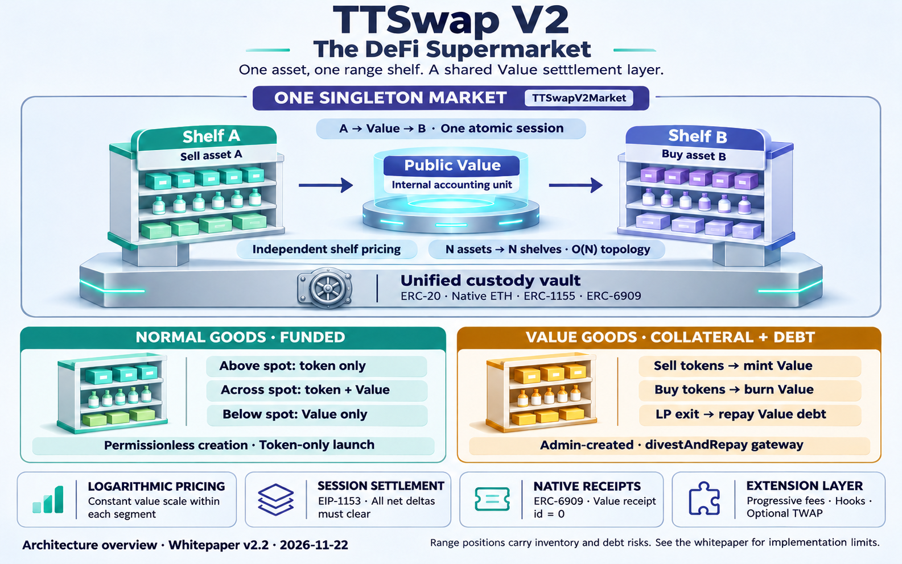

<p align="right">
  <strong>English</strong> | <a href="./README_CN.md">简体中文</a>
</p>

# TTSwap V2 — The DeFi Supermarket

<p align="center">
  
</p>

<p align="center">
  <strong>One asset, one range shelf. A shared Value settlement layer.</strong>
</p>

<p align="center">
  <a href="https://ttswap.io">Website</a> ·
  <a href="https://docs.ttswap.io">Documentation</a> ·
  <a href="https://github.com/ttswap/v2-ttswap-core/blob/master/doc/whitepaper.md">Technical whitepaper</a> ·
  <a href="https://discord.gg/XygqnmQgX3">Discord</a> ·
  <a href="https://twitter.com/ttswapfinance">X / Twitter</a>
</p>

## About TTSwap V2

**TTSwap V2** is a decentralized exchange protocol designed around **single-token range shelves** and a **constant-value logarithmic pricing kernel**. Each registered asset has an independent shelf inside one `TTSwapV2Market`, which also provides shared custody and settlement.

Instead of maintaining every possible asset pair, **N assets use N shelves**. A swap sells asset A for the protocol's **Public Value** accounting unit, then spends that Value to buy asset B in the same atomic session:

```text
Asset A → Shelf A → Public Value → Shelf B → Asset B
          sell                      buy
         └──────── one atomic session ────────┘
```

Value is an internal unit of account. In `swapGoods`, the intermediate amount passes directly between the two pricing legs without an external intermediate-token transfer. It can also be represented by an ERC-6909 receipt (`id = 0`) for use across transactions. The **O(N)** improvement describes shelf topology; execution cost still depends on liquidity boundaries, hooks, and settlement operations.

This overview follows [whitepaper v2.2, dated 2026-11-22](https://github.com/ttswap/v2-ttswap-core/blob/master/doc/whitepaper.md), based on core commit [`97eb7aa`](https://github.com/ttswap/v2-ttswap-core/commit/97eb7aa34e035460ae79b62035afc0c304b366ec).

## How liquidity works

The accounting model is determined by the good's type:

| | Normal goods | Value goods |
| :--- | :--- | :--- |
| Creation | Permissionless | `MarketAdmin` permission required |
| Position model | Funded | Collateral + Value debt |
| Genesis | Token-only range above the initial spot price | Token-only collateral range below the initial spot price |
| Trading | Buys convert token inventory into Value; sells reverse that process | Selling tokens mints Value and adds LP debt; buying tokens burns Value and reduces debt |
| LP exit | Returns tokens and/or Value according to the exit price, with accrued fees settled | Returns collateral and absorbed tokens; the position's Value debt must be repaid in the same session |

For **normal goods**, the LP's range determines the required funding:

- **Above spot:** tokens only — a range sell order.
- **Across spot:** tokens + Value — two-sided liquidity.
- **Below spot:** Value only — a range buy order.

Issuers can launch an normal-good shelf with token inventory alone, without paired stablecoin reserves. For value-good LPs, the main gateway's `divestAndRepay` can sell part of the withdrawn tokens to raise Value for repayment within one transaction, subject to available liquidity and protocol limits.

## Protocol building blocks

| Component | Role |
| :--- | :--- |
| **Logarithmic pricing** | Within each fixed-liquidity segment, the virtual value scale is constant: `p = C_V / C_Q`. Selling integrates the curve with a logarithm; buying uses its exponential inverse, with conservative rounding. Virtual reserves are distinct from physical vault balances. |
| **Range organization** | Each shelf uses geometric price Tiers and Zone-aligned LP boundaries. Crossing initialized liquidity boundaries updates the active curve. |
| **Session accounting** | `unlock` / `unlockFor` use EIP-1153 transient storage to track net deltas. Every outstanding delta must be cleared before the session exits. |
| **Unified custody and receipts** | The market supports ERC-20, native ETH, ERC-1155, and ERC-6909 assets, with an ERC-6909 receipt ledger and direct deposit/withdraw paths. Fee-on-transfer tokens require Push & Sync settlement; rebasing tokens are unsupported. |
| **Fees and extensions** | Progressive fees apply across initialized boundaries. Configurable commissions, bidirectional hooks, and an optional Tier-based geometric TWAP / realized-variance oracle extend each shelf. |

## Implementation status and limits

The whitepaper records **502 passing tests across 84 suites**, including its research verification suite, at the referenced baseline. These results do not establish complete formal verification: long-running mixed-operation stateful invariants and multi-value-good depeg stress simulations remain coverage gaps, and Halmos tests require a separate run.

Before deployment or integration, review [the whitepaper's implementation limits and validation status](https://github.com/ttswap/v2-ttswap-core/blob/master/doc/whitepaper.md), including:

- **Deployment size:** at that baseline, Market runtime bytecode is 59,252 bytes and Previewer is 26,192 bytes, both above the standard EIP-170 limit of 24,576 bytes. Deployment under that limit requires further contract restructuring.
- **Liquidity and debt risks:** range positions retain inventory exposure; value-good depegs can transmit risk through shared Value. Exit liquidity, debt repayment, and the minimum active-liquidity requirement constrain the last active LP's withdrawal.
- **Fee and oracle scope:** progressive-fee depth persists within one transaction, and resets across transactions even in the same block. Oracle observations are boundary-triggered and have no fixed heartbeat.

## V2 repositories

| Repository | Focus |
| :--- | :--- |
| [v2-ttswap-core](https://github.com/ttswap/v2-ttswap-core) | Solidity market, logarithmic math, shelves, gateways, receipt ledger, and Foundry tests |
| [v2-ttswap-frontend](https://github.com/ttswap/v2-ttswap-frontend) | Swap and liquidity interfaces |
| [v2-ttswap-indexer](https://github.com/ttswap/v2-ttswap-indexer) | Rust event indexing and query services |
| [v2-ttswap-subgraph](https://github.com/ttswap/v2-ttswap-subgraph) | The Graph event indexing and analytics |
| [v2-ttswap-doc](https://github.com/ttswap/v2-ttswap-doc) | Documentation and protocol explainers |
| [v2-ttswap-security](https://github.com/ttswap/v2-ttswap-security) | Security research, threat models, and verification specifications |
| [v2-ttswap-marketing](https://github.com/ttswap/v2-ttswap-marketing) | Brand assets, research, and community materials |

## Contributing and security

Start with the relevant V2 repository and its contribution guide. The core guides are available in [English](https://github.com/ttswap/v2-ttswap-core/blob/master/CONTRIBUTING_EN.md) and [简体中文](https://github.com/ttswap/v2-ttswap-core/blob/master/CONTRIBUTING_CN.md).

For contribution tracking, include your EVM wallet address in the PR template where required. Maintainers record approved contributions in the repository's `CONTRIBUTIONS.md`; scoring and retroactive incentive rules follow that repository's published guidelines.

Report sensitive vulnerabilities privately to [security@ttswap.io](mailto:security@ttswap.io).

## 简体中文概览

**TTSwap V2** 以“单币区间货架 + 公共 Value 清算”组织交易市场：每种注册资产对应一个独立货架，共享单例市场的资产托管与结算设施，N 种资产只需 N 个货架。

- **跨货架兑换**：同一原子会话内执行 `资产 A → Value → 资产 B`；Value 是内部记账单位，也可表示为 ERC-6909 `id = 0` 收据。
- **普通商品实缴仓**：支持无许可创建；现价上方存代币、跨现价存代币与 Value、现价下方存 Value。发行方可仅用代币库存启动货架。
- **价值商品负债仓**：由管理员许可创建，采用“抵押 + Value 负债”；卖入代币铸出 Value、买回代币销毁 Value，LP 撤资须在同一会话内偿债。
- **会话净额结算**：EIP-1153 跟踪会话差额，退出前必须全部平账；统一金库支持四类资产标准，原生 ERC-6909 账本记录收据。
- **实现边界**：本页依据白皮书 v2.2（2026-11-22、`97eb7aa`）。该基线的 Market 与 Previewer 字节码仍超标准 EIP-170 上限；LP 存在库存、脱锚传导与撤资偿债风险，跨区费率深度仅在单笔交易内累计。部署或集成前请阅读白皮书的限制与验证章节。

## Official resources

- **Website:** [ttswap.io](https://ttswap.io)
- **Documentation:** [docs.ttswap.io](https://docs.ttswap.io)
- **Whitepaper:** [Core technical whitepaper](https://github.com/ttswap/v2-ttswap-core/blob/master/doc/whitepaper.md)
- **X / Twitter:** [@ttswapfinance](https://twitter.com/ttswapfinance)
- **Discord:** [TTSwap community](https://discord.gg/XygqnmQgX3)
- **Telegram:** [@ttswapfinance](https://t.me/ttswapfinance)
- **Security:** [security@ttswap.io](mailto:security@ttswap.io)
- **Business:** [bussiness@ttswap.io](mailto:bussiness@ttswap.io)
