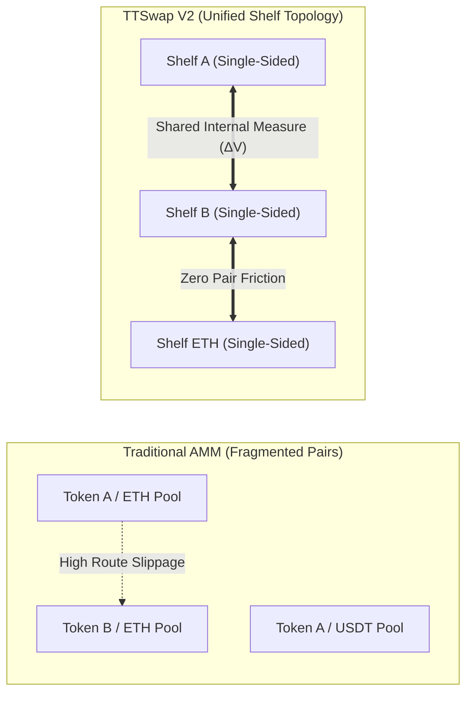

# Welcome to the TTSwap GitHub Organization 🚀

  

  <strong>The Next-Generation Constant Value AMM (CV-AMM) & Single-Sided Liquidity Architecture</strong>

  
  
  
  
  

---

## 💡 About TTSwap V2

**TTSwap V2** is a revolutionary decentralized exchange (DEX) protocol built on EVM-compatible networks. By departing from the conventional, fragmented "paired token pool" paradigm ($O(N^2)$ liquidity routing friction), TTSwap introduces the **Constant Value Automated Market Maker (CV-AMM)**. 

In TTSwap V2, every digital asset operates on its own **Single-Sided Range Shelf**, linked directly to a protocol-wide invariant virtual measure ($\Delta V$). This reduces systemic trading and market-making complexity across $N$ arbitrary assets to $O(N)$.

---

## ⚡ Core Protocol Innovations

### 1. Pure Single-Sided Liquidity Provisioning
Liquidity providers deposit only the specific token they wish to hold. Market makers are completely freed from forced exposure to volatile counter-assets and paired impermanent loss (IL). Normal goods function as physical inventories, while value goods operate as collateralized debt positions.

### 2. Logarithmic Integral Pricing Curves
Swapping asset $A$ into asset $B$ executes via a deterministic two-leg definite integral calculation:

$$\Delta V = V_A \cdot \ln\left(\frac{Q_A + x}{Q_A}\right)$$

$$y = Q_B \cdot \left(1 - \exp\left(-\frac{\Delta V}{V_B}\right)\right)$$

This mathematical formulation bounds price impact smoothly and convexly across wide depth zones, preventing zero-cost sandwich manipulation.

### 3. EIP-1153 Transient Accounting Sessions
Multi-hop trades and combined invest/divest operations execute within an ephemeral flash-accounting session (`unlock` / `unlockFor`). Net token settlements occur only once at the conclusion of the transaction (`nonzeroDeltaCount == 0`), drastically cutting EVM gas overhead.

### 4. Dual-Track Invariant Solvency
Collateralized debt positions are governed by continuous solvency monitoring and dual-track liquidations, formally proven via symbolic execution and automated property invariants.

---

## 📦 V2 Repository Ecosystem

The TTSwap codebase is modularized across specialized sub-repositories. All new protocol development, audits, and feature requests center around the **V2 stack**:

| Repository | Description | Primary Technology |
| :--- | :--- | :--- |
| [**`v2-ttswap-core`**](https://github.com/ttswap/v2-ttswap-core) | CV-AMM core settlement hub, single-token shelves, EIP-1153 vault & liquidation engine | Solidity `0.8.29` / `0.8.37`, Foundry |
| [**`v2-ttswap-frontend`**](https://github.com/ttswap/v2-ttswap-frontend) | Web3 terminal for single-sided LPing, token swaps, and real-time lightweight charting | React 19, Wagmi v2, Viem, Tailwind CSS |
| [**`v2-ttswap-indexer`**](https://github.com/ttswap/v2-ttswap-indexer) | Ultra-high-throughput chain event ingestion and GraphQL API server | Rust 2021, Alloy 0.8, Tokio, Axum, PostgreSQL |
| [**`v2-ttswap-subgraph`**](https://github.com/ttswap/v2-ttswap-subgraph) | Decentralized event indexing and TWL (Time-Weighted Liquidity) analytical pipeline | AssemblyScript, The Graph Protocol |
| [**`v2-ttswap-doc`**](https://github.com/ttswap/v2-ttswap-doc) | Official bilingual documentation portal, mathematical whitepapers, and SDL specs | Docusaurus, TypeScript, KaTeX |
| [**`v2-ttswap-security`**](https://github.com/ttswap/v2-ttswap-security) | Threat modeling, Certora CVL formal verification, Halmos symbolic proofs, and bounty specs | Certora, Halmos, Echidna, Foundry |
| [**`v2-ttswap-marketing`**](https://github.com/ttswap/v2-ttswap-marketing) | Brand design guidelines, media assets, DEX benchmarking research, and partnership decks | Vector SVG, Python Benchmarks |

> [!NOTE]
> **V1 Legacy Repositories**: The original V1 repositories (`ttswap-core`, `ttswap-frontend`, `ttswap-subgraph`) are permanently paused and no longer accept PRs. All contributors should direct their efforts exclusively to the `v2-*` repositories listed above.

---

## 🛡️ Bug Bounty & Retroactive Contributions

TTSwap operates an open, transparent, and merit-based contribution tracking system.

1. **Quantified Contribution Scoring**: Every merged PR across our repositories is assigned a verifiable contribution score based on technical difficulty ($T_1 \sim T_4$) and repository domain weights:
   $$\text{Final Score} = \text{Base Points} \times \text{Topic Weight} \times \text{Risk Multiplier}$$
2. **EVM Wallet Binding**: Contributors must provide their EVM wallet address in PR submissions. Approved contributions are permanently recorded in each repository's `CONTRIBUTIONS.md`.
3. **Retroactive Airdrop & Revenue Sharing**: Confirmed contribution points serve as the official allocation ledger for retroactive token airdrops and protocol revenue distributions upon TGE or dividend events.
4. **Responsible Vulnerability Disclosure**: Security researchers uncovering smart contract vulnerabilities or mathematical solvency exploits are rewarded via our dedicated Bug Bounty Program. For sensitive reports, contact `security@ttswap.io`.

---

## 🌐 简体中文概览 (Chinese Summary)

**TTSwap V2** 是首个在 EVM 链上落地的“恒定价值做市商（CV-AMM）”去中心化交易所：
- **纯单币做市**：用户无需被动组对，向单一资产货架存入代币即可开始赚取手续费，杜绝传统双币做市的无常损失；
- **全资产互联**：$N$ 个代币仅需 $N$ 个货架，跨货架兑换通过公共价值度量（$\Delta V$）秒级结算，彻底消除池子割裂；
- **极速高性能技术栈**：核心智能合约全面应用 EIP-1153 瞬时借贷；链下采用 Rust + Alloy 自研毫秒级索引器与 The Graph 双轨索引；
- **开源贡献激励**：V1 项目已全线归档并暂停维护，所有开发集中于 `v2-*` 系列。欢迎社区提交 PR 并绑定 EVM 钱包，所有有效贡献均将永久记账并在项目发币或分红时享受追溯空投分配。

---

## 🔗 Official Resources & Links

- 🌐 **Official Website**: [ttswap.io](https://ttswap.io)
- 📚 **Technical Documentation**: [docs.ttswap.io](https://docs.ttswap.io)
- 📄 **Whitepaper v2.2**: [Docusaurus Whitepaper Section](https://docs.ttswap.io/docs/whitepaper)
- 🐦 **Twitter / X**: [@ttswapfinance](https://twitter.com/ttswapfinance)
- 💬 **Discord**: [TTSwap Official Discord](https://discord.gg/XygqnmQgX3)
- ✈️ **Telegram**: [@ttswapfinance](https://t.me/ttswapfinance)
- 🔒 **Security Contact**: [security@ttswap.io](mailto:security@ttswap.io)
- 💼 **Business Inquiries**: [bussiness@ttswap.io](mailto:bussiness@ttswap.io)
