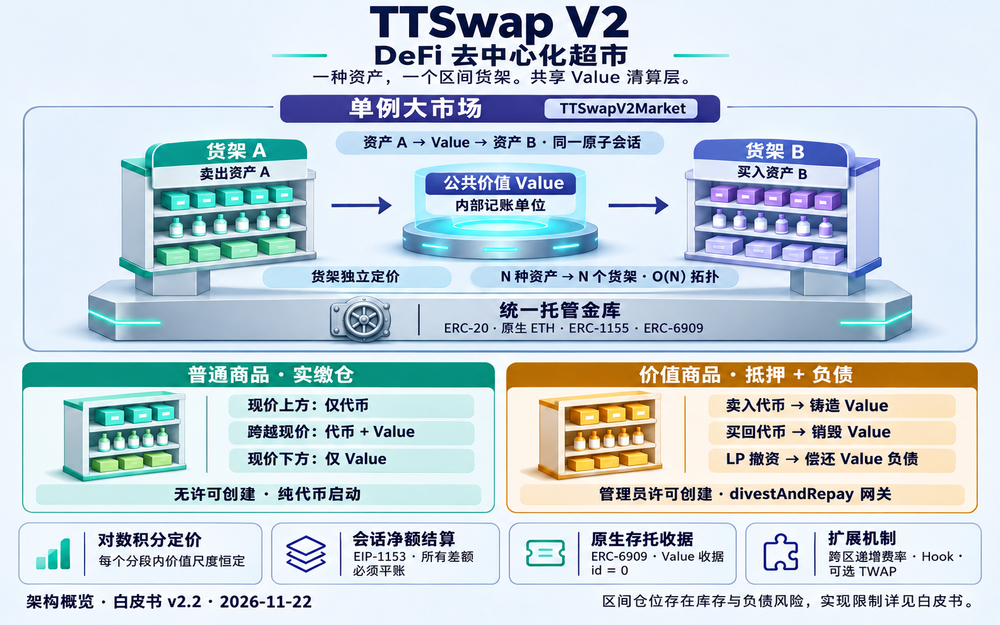

<p align="right">
  <a href="./README.md">English</a> | <strong>简体中文</strong>
</p>

<p align="center">
  
</p>

<p align="center">
  <strong>一种资产，一个区间货架。共享 Value 清算层。</strong>
</p>

<p align="center">
  <a href="https://ttswap.io">官方网站</a> ·
  <a href="https://docs.ttswap.io">技术文档</a> ·
  <a href="https://github.com/ttswap/v2-ttswap-core/blob/master/doc/whitepaper.md">技术白皮书</a> ·
  <a href="https://discord.gg/XygqnmQgX3">Discord 社区</a> ·
  <a href="https://twitter.com/ttswapfinance">X / Twitter</a>
</p>

## 关于 TTSwap V2

**TTSwap V2** 是围绕**单币区间货架**与**恒定价值对数积分内核**设计的去中心化交易协议。每种注册资产在同一个 `TTSwapV2Market` 中拥有独立货架，共享市场提供的资产托管与结算设施。

无需为所有资产组合分别建立交易对，**N 种资产只需 N 个货架**。跨货架兑换先卖出资产 A，换取协议的**公共价值 Value**，再在同一原子会话内用 Value 买入资产 B：

```text
资产 A → 货架 A → 公共 Value → 货架 B → 资产 B
          卖出                  买入
         └────── 同一原子会话 ──────┘
```

Value 是内部记账单位。在 `swapGoods` 中，中间 Value 数量直接在两段定价过程之间传递，无需外部中间代币转账。Value 也可表示为 ERC-6909 收据（`id = 0`），用于跨交易流通。**O(N)** 描述的是货架拓扑规模；实际执行成本仍取决于流动性边界、Hook 与结算操作。

本概览依据[白皮书 v2.2（2026-11-22）](https://github.com/ttswap/v2-ttswap-core/blob/master/doc/whitepaper.md)，对应核心代码基线提交 [`97eb7aa`](https://github.com/ttswap/v2-ttswap-core/commit/97eb7aa34e035460ae79b62035afc0c304b366ec)。

## 流动性如何运作

商品类型唯一决定仓位的记账模型：

|          | 普通商品（Normal Goods）                            | 价值商品（Value Goods）                                          |
| :------- | :-------------------------------------------------- | :--------------------------------------------------------------- |
| 创建权限 | 无许可创建                                          | 需经 `MarketAdmin` 许可                                          |
| 仓位模型 | 实缴仓（Funded）                                    | 抵押 + Value 负债（Collateral + Debt）                           |
| 创世注资 | 在初始现价上方区间纯代币注资                        | 在初始现价下方区间纯代币抵押                                     |
| 交易过程 | 买入将代币库存转为 Value 权益；卖出执行相反过程     | 卖入代币铸造 Value 并增加 LP 负债；买回代币销毁 Value 并减少负债 |
| LP 撤资  | 按退出时的现价返还代币与/或 Value，并结算累计手续费 | 返还抵押与已吸收代币，须在同一会话内偿还仓位的 Value 负债        |

对于**普通商品**，LP 区间相对现价的位置决定注资构成：

- **现价上方**：仅存代币，形成区间卖盘。
- **跨越现价**：存入代币 + Value，提供双边流动性。
- **现价下方**：仅存 Value，形成区间买盘。

发行方可仅用代币库存启动普通商品货架，无需配对稳定币准备金。对于价值商品 LP，主网关的 `divestAndRepay` 可在同一笔交易中卖出部分撤回代币，筹集 Value 偿债；该通道受可用流动性与协议限制约束。

## 协议核心组件

| 组件               | 作用                                                                                                                                                      |
| :----------------- | :-------------------------------------------------------------------------------------------------------------------------------------------------------- |
| **对数积分定价**   | 在固定流动性分段内，虚拟价值尺度保持恒定：`p = C_V / C_Q`。卖出采用对数积分，买入采用其指数逆运算，并执行保守舍入。虚拟储备与金库的实际资产余额相互区分。 |
| **区间组织**       | 每个货架使用几何价格阶梯 Tier 与按 Zone 对齐的 LP 边界；穿越已初始化的流动性边界时，更新活跃曲线。                                                        |
| **会话记账**       | `unlock` / `unlockFor` 通过 EIP-1153 暂态存储追踪净额差异；会话退出前，所有未结差额必须全部平账。                                                         |
| **统一托管与收据** | 市场支持 ERC-20、原生 ETH、ERC-1155 和 ERC-6909 资产，内建 ERC-6909 收据账本及直接存取通道。转账扣税代币必须使用 Push & Sync 结算；不支持弹性余额代币。   |
| **费率与扩展**     | 穿越已初始化边界时采用递增费率；各货架可配置分佣、双向 Hook，以及可选的 Tier 几何均价 TWAP / 已实现方差预言机。                                           |

## 实现状态与限制

白皮书在所引用的代码基线上记录了 **84 个套件、502 项测试全部通过**，其中包含独立研究验证套件。这些结果不代表完整形式化验证：长时间、多操作混合状态机不变量测试，以及多价值商品脱锚压力仿真仍存在覆盖缺口；Halmos 测试也需独立运行。

部署或集成前，请阅读[白皮书中的实现限制与验证状态](https://github.com/ttswap/v2-ttswap-core/blob/master/doc/whitepaper.md)，尤其关注：

- **部署体积**：该基线的 Market 运行时字节码为 59,252 字节，Previewer 为 26,192 字节，均超过标准 EIP-170 的 24,576 字节上限。在这一限制下部署前，仍需进一步拆分合约。
- **流动性与负债风险**：区间仓位仍承担库存敞口；价值商品脱锚可能通过公共 Value 传导风险。退出流动性、负债偿还与最低活跃流动性要求，会约束最后一位活跃 LP 的撤资。
- **费率与预言机作用范围**：跨区费率深度仅在单笔交易内累计；即使处于同一区块，跨交易也会重置。预言机观测由穿越边界触发，没有固定心跳。

## V2 仓库导航

| 仓库                                                                 | 主要内容                                                     |
| :------------------------------------------------------------------- | :----------------------------------------------------------- |
| [v2-ttswap-core](https://github.com/ttswap/v2-ttswap-core)           | Solidity 市场、对数数学、货架、网关、收据账本及 Foundry 测试 |
| [v2-ttswap-frontend](https://github.com/ttswap/v2-ttswap-frontend)   | 兑换与流动性操作界面                                         |
| [v2-ttswap-indexer](https://github.com/ttswap/v2-ttswap-indexer)     | Rust 事件索引与查询服务                                      |
| [v2-ttswap-subgraph](https://github.com/ttswap/v2-ttswap-subgraph)   | 基于 The Graph 的事件索引与分析                              |
| [v2-ttswap-doc](https://github.com/ttswap/v2-ttswap-doc)             | 技术文档与协议说明                                           |
| [v2-ttswap-security](https://github.com/ttswap/v2-ttswap-security)   | 安全研究、威胁模型与验证规范                                 |
| [v2-ttswap-marketing](https://github.com/ttswap/v2-ttswap-marketing) | 品牌素材、研究与社区资料                                     |

## 参与贡献与安全报告

请从对应的 V2 仓库及其贡献指南开始。核心仓库提供[英文贡献指南](https://github.com/ttswap/v2-ttswap-core/blob/master/CONTRIBUTING_EN.md)和[简体中文贡献指南](https://github.com/ttswap/v2-ttswap-core/blob/master/CONTRIBUTING_CN.md)。

如仓库要求贡献追踪，请在 PR 模板中填写 EVM 钱包地址。维护者会在仓库的 `CONTRIBUTIONS.md` 中记录获认可的贡献；评分与追溯激励按对应仓库公布的规则执行。

涉及敏感漏洞，请通过 [security@ttswap.io](mailto:security@ttswap.io) 私下报告。

## 官方资源

- **官方网站**：[ttswap.io](https://ttswap.io)
- **技术文档**：[docs.ttswap.io](https://docs.ttswap.io)
- **技术白皮书**：[核心协议白皮书](https://github.com/ttswap/v2-ttswap-core/blob/master/doc/whitepaper.md)
- **X / Twitter**：[@ttswapfinance](https://twitter.com/ttswapfinance)
- **Discord**：[TTSwap 社区](https://discord.gg/XygqnmQgX3)
- **Telegram**：[@ttswapfinance](https://t.me/ttswapfinance)
- **安全联系**：[security@ttswap.io](mailto:security@ttswap.io)
- **商务联系**：[bussiness@ttswap.io](mailto:bussiness@ttswap.io)
